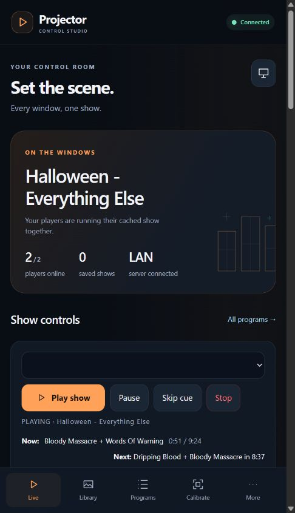
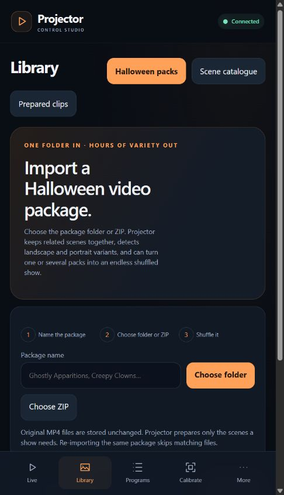
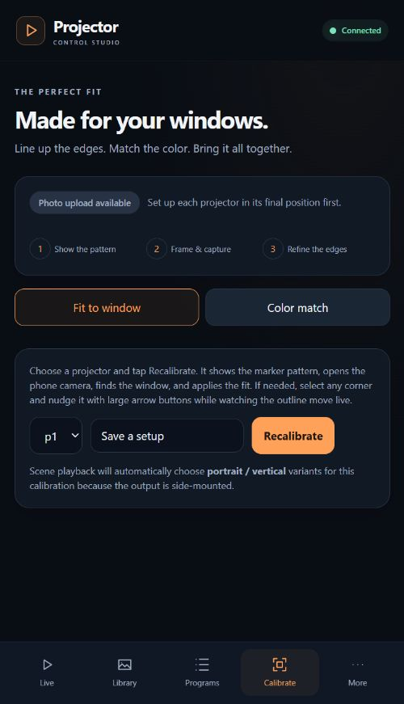
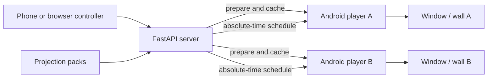

# Projector

**Turn any number of cheap Android TV sticks and projectors into one synchronized Halloween display.**

Projector catalogs projection-video packs, prepares only the clips a show needs, and schedules characters across windows, walls, or props. Each stick caches media before playback; the server sends a shared absolute-time schedule so the display keeps running without live video streaming.

> Projector is independent open-source software. It does not include commercial projection videos and is not affiliated with AtmosFX, HalloweenFX, or any other content publisher. Import only media you are licensed to use.

<p align="center">
  
  
  
</p>

## What it does

- Runs one show across **two projectors or twenty**. Programs target named surfaces rather than hard-coded devices.
- Imports a named **folder or ZIP** as a coherent Halloween package. It retains original MP4s, detects scenes and variants, and prepares media on demand.
- Builds endless, repeatable **shuffle marathons** from one or several packages. Characters cycle before reuse, related collections stay together, and multiple surfaces remain active.
- Catalogs portrait/landscape, window/wall/TV, black-background, enclosure, buffer, character, action, and collection variants.
- Uses local cut/activity analysis to find entrances, exits, quiet handles, and movement that can continue across adjacent windows.
- Calibrates each output with GPU corner pinning, masks, mirroring, rotation, color, and named placement profiles.
- Provides one Android APK with two roles: a TV-stick player and a phone controller with camera-assisted calibration.
- Keeps playback local and deterministic. Network generation services are never in the runtime playback path.
- Optionally builds custom creatures through local ComfyUI workflows with image approval before animation and sound review before publication.

## Package import in three steps

1. Open **Library → Halloween packs** and name the pack.
2. Choose its folder or ZIP. The server stores MP4 originals unchanged and scans the folder structure and filenames.
3. Select one or more package cards and press **Shuffle selected packs**.

The resulting Program is a continuous scheduler. It groups scenes into collections and characters, selects output variants after calibration, maintains per-surface spacing, and uses a fresh seed each run. Open **Scene catalogue** to correct a title, grouping, rotation, surface type, or movement guess.

See [Importing projection packs](docs/IMPORTING_PACKS.md) for naming tips and copyright guidance.

## Quick start with Docker

Requirements:

- A Windows, macOS, or Linux machine on the same LAN as the players
- Docker Desktop / Docker Engine with Compose
- One Android TV or Google TV device per projector (Android 8+)

```bash
git clone https://github.com/d8ahazard/projector.git
cd projector
cp docker/.env.example docker/.env
docker compose --env-file docker/.env -f docker/docker-compose.yml up -d --build
```

Edit `docker/.env` first:

```env
PROJECTOR_PUBLIC_HOST=192.168.1.50
PROJECTOR_WORK_DIR=D:/ProjectorAppData
PROJECTOR_SOURCE_ROOT=D:/ProjectionPacks
```

Open `http://localhost:8000`, then install the APK from the latest GitHub release or build it locally:

```bash
docker compose -f docker/docker-compose.yml --profile apk run --rm apk
```

The server displays an install QR and a guided **Add a stick** tutorial. A factory-stock Android TV device requires one initial Wireless debugging pairing; after provisioning, signed updates, app restarts, playback, calibration, and maintenance recovery are handled over the LAN.

Detailed setup:

- [Windows service installation](docs/INSTALL_WINDOWS.md)
- [Android players and controller](docs/ANDROID_PLAYERS.md)
- [Importing projection packs](docs/IMPORTING_PACKS.md)
- [Programs and smart scheduling](docs/PROGRAMS.md)
- [Calibration](docs/CALIBRATION.md)
- [Local AI generation](docs/AI_GENERATION.md)
- [Architecture](docs/ARCHITECTURE.md)
- [Publishing releases](docs/RELEASING.md)

## How synchronization works



The server compiles programs into concrete per-surface asset IDs after considering calibration and output orientation. Players download a rolling cache window, report clock offset and readiness, then start on shared timestamps. Each Android player renders corner pinning and masking in its GPU shader; calibration does not re-encode video.

## Repository layout

- `server/` — FastAPI, SQLite, FFmpeg/OpenCV/PySceneDetect processing, scheduler, WebSocket sync
- `web/` — React controller UI served by the backend
- `android/` — Media3 player plus native phone-controller shell
- `scripts/` — Windows service, player build, provisioning, and validation utilities
- `docker/` — reproducible server and APK builds
- `docs/` — operator, architecture, calibration, release, and launch documentation

## Development

Server (Python 3.10+ and [uv](https://docs.astral.sh/uv/)):

```bash
cd server
uv sync
uv run uvicorn app.main:app --reload --port 8000
uv run pytest
```

Web UI:

```bash
cd web
npm ci
npm run dev
npm run build
```

Android:

```bash
cd android
gradle testDebugUnitTest assembleDebug
```

The current test suite covers catalogue rescans, package imports, duplicate handling, orientation correction, calibration profiles, arbitrary surface counts, marathon scheduling, movement links, player management, and media cadence/audio behavior.

## Security model

Projector is designed for a trusted private LAN. The controller API can start shows, update players, and provision explicitly selected Android TV devices. Do not expose port 8000 directly to the public Internet. Read [SECURITY.md](SECURITY.md) before remote access or public deployment.

## Media and trademarks

Commercial media is never committed to this repository or attached to releases. Package metadata and thumbnails remain in the user's local data directory. Product names used in compatibility documentation belong to their respective owners. See [THIRD_PARTY_CONTENT.md](THIRD_PARTY_CONTENT.md).

## License

Projector's source code is released under the [MIT License](LICENSE). Imported media, generated media, models, fonts, and third-party dependencies keep their own licenses.
