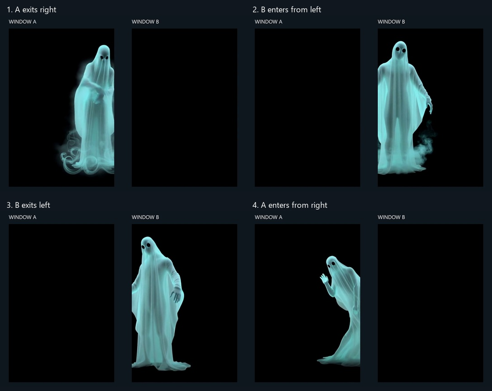

# Local AI generation

The optional Creature Studio turns a concept into an approved character reference, approved starting images, animated actions with sound, and a reusable multi-window encounter.

The default workflow expects local ComfyUI services and local model storage. No project media needs to leave the LAN. Generation is gated:

1. approve the character design
2. approve each starting image
3. render a short action
4. review motion and sound
5. approve and publish the take

Five-second actions are the default. Longer shows assemble entrances, actions, idle loops, exits, and handoffs. Finishing can interpolate motion before constant-frame-rate delivery, while preserving source duration and remuxing audio after interpolation. Interpolation operates inside takes and never across cuts.

Model weights and custom workflows are not distributed with Projector. Their licenses and hardware requirements vary.

